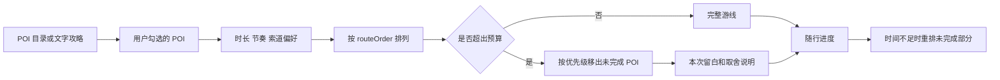

# 澄路：黄龙 POI 游线规划原型

2026-10-08 山水护照：六枚原创景点纪念章、三项对照观察实验、三种主题收集、可编辑/导出的多页数字手账已接入随行页。详见 [护照使用说明](docs/passport-guide.md)、[实体纪念品联动策划](docs/黄龙山水护照与实体纪念品联动策划.md) 与 [含设计图的阅读版](docs/passport-proposal.html)。

这是一个浏览器原型，用来验证黄龙这类游览自由度有限的景区，是否应先让游客选 POI，再给出能解释取舍的游线。它模拟微信小程序的信息密度与操作节奏，但不是可上线的小程序，也不替代景区现场导览。

2026-09-18 版本以手机竖屏为主要界面，提供独立地图页、68 个景点与设施、分类搜索、入口查看和可选起终点的高德步行查询。详细布局、设施来源与验证说明见 [移动端地图与设施说明](MOBILE-MAP-GUIDE.md)。

在线演示：[huanglong-route.itsmephrynx.workers.dev](https://huanglong-route.itsmephrynx.workers.dev/)。已部署至 Cloudflare，支持真实高德底图和设施步行查询；访问者无需运行本机服务。部署结构、密钥配置与更新方法见 [Cloudflare 部署说明](CLOUDFLARE.md)，部署工具需要 Node.js 22+。

景点扩充版采用方形卡片：320–469px 内容区每排两张，470px 起每排三张；可按彩池、瀑布、地貌、人文或已加入筛选。每处景点提供详细背景、观察细节、拍照建议和可核查来源，详见 [景点内容与资料说明](SCENIC-CONTENT-GUIDE.md)。

2026-09-20 导览更新：14 处景点均增加“看哪里 / 怎么取舍 / 来前知道”。先展示看点与游览建议，景观故事按需展开；卡片时间明确为参考停留，不含到达、换观景位置与返程。五彩池区分附近定位与实际观景视角，黄龙洞说明开放未确认。详见[本轮内容设计与验证](docs/POI-VISITOR-GUIDE.md)。

2026-09-20 随行连续过程版：四个独立 Three.js 场景随 POI 手动到达解锁。转动水槽打通持续水流、拖动建模 CO₂ 气团观察岩石溶解、拖水位让山体泉水出露、拖动同一滴水去下一处（或点按钮带它出发），逐池观看池沿生长—蓄水—溢流；去掉模型数字标识，加入过渡和粒子，保留四章印记与存档迁移。[直接进入随行](https://huanglong-route.itsmephrynx.workers.dev/?view=follow&v=water-anchor-20260920)。代码在 `feature/fluid-water-story`，回退标签 `archive/2026-09-20-before-water-anchor` 保留本轮前的连续过程版。见[玩法、模型与回退说明](docs/WATER-DROP-GUIDE.md)及[本轮实施记录](docs/FLUID-STORY-PLAN.md)。

## 打开原型

需要本机已有 Node.js 20 或更新版本，无需安装 npm 依赖。地图需要配置下列高德开发环境变量：

```text
AMAP_JSAPI_KEY
AMAP_JSAPI_SECURITY_CODE
```

在本目录运行：

```powershell
powershell -ExecutionPolicy Bypass -File .\start-demo.ps1
```

脚本会优先在 `127.0.0.1:4173` 启动一个零依赖的本机服务；端口已被占用时会自动选择下一个空闲端口，并打开对应地址。

```text
http://127.0.0.1:4173
```

也可以手动运行：

```powershell
node .\server.js
```

随后访问同一地址。服务仅监听 `127.0.0.1`；它不会把密钥写入源文件或输出到终端。

也可使用 `npm start`。克隆仓库后不会自带密钥，需要在自己的环境中配置上述变量。设施资料快照可直接搜索；没有高德配置时地图会提示未连接。

运行项目自带的目录、规划与 Cloudflare 代理检查：

```powershell
node --test tests/*.test.cjs
```

等价命令为 `npm test`。测试不需要高德令牌，也不访问网络。实验版的三维模型测试需要先运行 `npm.cmd ci` 安装开发依赖；浏览原型本身使用已提交的本地打包文件。

直接打开 `index.html` 仍能查看 POI 目录、详情页、文字匹配、游线取舍和随行状态，但不会加载高德地图，因为缺少本机的 `/runtime-config.js` 配置端点。

## 本次可以操作的流程

1. 默认进入“地图”。高德地图占满顶部标题与底部导航之间的区域，支持拖动、触摸缩放，以及右侧放大、缩小、总览和 3D 按钮。
2. 切换“全部 / 景点 / 厕所 / 索道接驳 / 商店补给 / 医疗 / 便民”，搜索框在当前类别内匹配已收录名称、别名和地址。分类栏可横向滑动。
3. 底部卡片可展开为列表，也可收起为标题。点击地点在地图上定位，点击“设施详情”查看地址、资料开放时间、公开电话和入口位置；未知字段明确显示未提供。
4. 点击“到这里”，从全部收录地点中手动选择起点和终点，查询高德步行路径、用时及分段指引。默认起点为游客中心；这不是实时用户定位。
5. 在“发现”页浏览 14 个景观 POI，查看介绍并加入/移出行程。原有 16 个景观与服务节点均保留其 ID，并新增 5 个景观节点；设施页以“查看位置 / 到这里”为主要操作。
6. 在“游线”页调整可用时长、节奏和索道上行偏好，查看建议节点、估算、缓冲与取舍说明。
7. 点击“开始随行”，先手动确认到达、收下地点印章，再“逛完了”推进下一站；到关联景点后，解锁水滴四章中的独立小游戏。可直接在章节中选择对应景点补记到达，补记不跳过游线中的站点。途中可看本站玩法和拍照建议，在印章册生成 PNG 纪念卡。

“导入攻略”页保留了文字 POI 识别和截图/链接入口。当前轮没有读取外链、执行 OCR 或抓取社媒内容，避免在地图与 POI 目录尚未稳定前把产品边界混在一起。

## POI 目录

目录分为景观和服务设施。每个条目都含名称、别名、行程优先级、建议停留、步行负担、详情文案、坐标和坐标说明。前端只使用目录中的 ID 规划路线；文字匹配只能提出候选，不能凭空创建 POI。

| 类别 | POI | 坐标用途 |
| --- | --- | --- |
| 服务设施 | 黄龙游客中心、黄龙售票处 | 高德 POI 坐标；游客中心是设施步行规划的默认起点，可手动切换 |
| 索道/观光车 | 索道服务中心、索道上站售票点、观光车售票点 | 高德 POI 坐标；用于表达交通设施扩展接口 |
| 前段景观 | 迎宾池、莲台飞瀑、洗身洞观景台 | 高德 POI 坐标；作为景区游线骨架前段节点 |
| 安全服务 | 洗身洞医疗点 | 高德 POI 坐标；用于随行模式和设施步行规划 |
| 中段景观 | 金沙铺地、明镜倒影池、争艳彩池 | 前两项采用临近休息亭的原型定位点，争艳彩池使用高德 POI 坐标 |
| 人文节点 | 黄龙中寺、黄龙古寺 | 高德 POI 坐标 |
| 核心景观与休息 | 五彩池、五彩池休息亭 | 使用五彩池休息亭附近的原型定位点；用于高段游线表达 |

坐标使原型能在地图上建立正确的相对位置，但不等于官方景区边界、精确集合点、开放状态或无障碍路线数据。部分景观采用相邻服务点作为原型定位，详情页会明确写出这一点。

## 地图与路线的边界

页面同时使用两种不同来源的路线信息，不能混为一谈。

| 图层 | 实现 | 可以表达什么 | 不能表达什么 |
| --- | --- | --- | --- |
| 景区游线骨架 | 目录中的 `routeOrder` 与维护坐标，用 `AMap.Polyline` 绘制虚线 | 已选景观 POI 的建议浏览顺序和路线取舍 | 高德真实步行导航、单向规则、临时封路、精确距离或开放状态 |
| 设施步行路线 | 高德 JSAPI `AMap.Walking` | 手动指定起终点之间的高德步行查询结果 | 景区内部官方游览路线或服务设施实时可用性 |

这一区分是产品设计的一部分：黄龙内部的游览路网、季节管制、单向组织与服务状态应由景区专属数据维护，高德更适合为常规道路/设施之间的定位和步行查询提供补充。

## 高德 JSAPI 接入

`server.js` 在运行时读取环境变量，返回以下内存脚本：

```text
GET /runtime-config.js
```

前端在调用 `AMapLoader.load()` 前设置 `window._AMapSecurityConfig.securityJsCode`，然后加载 JSAPI 2.0、比例尺和步行规划插件；缩放等工具由页面按钮控制。地图实例使用 3D 模式，并在 `AMapLoader.load().then()` 的第一行设置指定的 `appname` 标识。

这是本机开发模式。JSAPI key 需要提供给浏览器，安全码也会在本机运行时配置中出现，因此该服务只绑定 loopback 地址。生产环境应由后端或云函数代理高德服务，使用 `serviceHost`，并限制来源、轮换密钥和监控配额；不要复制本机端点到公网。

若只配置了 `AMAP_SECURITY_JS_CODE`，本机服务也会将它作为安全码回退读取。`AMAP_WEBSERVICE_KEY` 只被本机 `scripts/refresh-facilities.cjs` 用于查询设施资料，不发送给前端。查询使用 `appname=amap-lbs-skill`，串行分页以控制频率。前端搜索读取 `data/facilities.js` 中的公开资料快照，不是每次输入都发起 Web Service 请求。

## 规划规则

规划器是解释性演示，不是最短路算法。



计算步骤如下：

1. 将已选 POI 按目录中的景区顺序排列。
2. 用可用时长减去返程缓冲，再根据游玩节奏调整预算。
3. 加入景观停留、步行负担、节点间过渡和“是否考虑索道”的原型估算。
4. 若超预算，只从未完成 POI 中移出优先级较低的条目；已抵达节点不被移除。
5. 将移出的条目按景区顺序显示为“本次留白”，保留选择理由。

时间、距离、优先级和索道节省量都是用来表达产品逻辑的样例参数。生产版需要用景区许可的路网、单向规则、实测耗时、季节策略和设施状态替代它们。

## 数据模型与后续接口

推荐把目录、游线规划和设施状态放在云函数或后端，而不是放在小程序端：

```text
GET  /v1/destinations/huanglong/pois
POST /v1/plans
GET  /v1/destinations/huanglong/facilities?near=lng,lat
POST /v1/imports/pois
```

POI 至少应包含：

```json
{
  "id": "five-color-pond",
  "name": "五彩池",
  "aliases": ["黄龙五彩池", "五彩池群"],
  "kind": "scenic",
  "location": [103.834717, 32.722579],
  "coordinateNote": "原型定位点：五彩池休息亭附近",
  "recommendedStayMinutes": 45,
  "priority": 10,
  "routeOrder": 9,
  "source": {"kind": "curated", "updatedAt": "2026-09-18"}
}
```

设施状态必须附带来源、更新时间和过期时间。正式版初期可以先接入静态厕所、休息亭、医疗点、索道与观光车节点，随后再扩展索道开闭、排队、班次、拥挤度和道路通行情况。

## 攻略与社媒链接的后续做法

本原型的约束保持不变：攻略内容的价值是发现 POI，不是替用户判断某个 POI 的实际体验。

文字先经过目录别名匹配；截图先 OCR 成文字，再进入同一匹配器；公开链接则由服务端平台适配器在允许范围内提取标题、摘要和可读取正文。模型、OCR 和外部搜索只能提出候选项，最终都必须映射到黄龙目录中已有的 `poiId`，再由用户确认加入行程。

不要要求用户提交登录凭据、Cookie 或私密内容。小红书、抖音等平台不应假设可稳定读取任意笔记；遇到登录限制、平台规则或页面变动时，应立刻回退为粘贴文字或上传截图。

## 文件说明

| 文件 | 作用 |
| --- | --- |
| `index.html` | 页面信息结构、地图容器、详情弹层与交互控件 |
| `app.js` | 服务节点、目录组合、发现筛选、文字匹配、规划规则与随行状态 |
| `data/scenic.js` | 14 个景观、长介绍、别名、照片与来源链接 |
| `map.js` | 地图目录合并、分类搜索、详情、入口定位与步行查询 |
| `style.css` / `mobile.css` | 基础视觉与手机竖屏布局、地图控件、POI 卡片和详情弹层 |
| `data/facilities.js` | 高德设施资料快照、查询时间与合并记录 |
| `scripts/refresh-facilities.cjs` | 本机设施查询、分页与快照更新 |
| `server.js` | 仅绑定 `127.0.0.1` 的静态服务与运行时高德开发配置端点 |
| `start-demo.ps1` | 启动本机服务并打开原型 |
| `tests/` | 可独立运行的 POI 目录、别名、设施分类与游线顺序检查 |
| `assets/` | 本地 Lucide 脚本、许可文件和两张景区照片 |

## 素材与许可

本地页面图标和两张景区照片随原型打包；景点卡片另按需加载黄龙官网公开资料图，并在详情列明出处。图片加载失败时显示示意背景，不影响阅读与选点。高德 JSAPI 也是运行时第三方资源：默认进入地图页时初始化地图；用户点击步行查询后才请求路线。设施搜索使用已取得的本地资料快照。

- `assets/huanglong-five-colored-pond.jpg`：Kounosu，*Water-of-Five-colored-Pond Huanglong Sichuan China*，CC BY-SA 3.0，来源：[Wikimedia Commons](https://commons.wikimedia.org/wiki/File:Water-of-Five-colored-Pond_Huanglong_Sichuan_China.jpg)。
- `assets/huanglong-welcome-ponds.jpg`：Kounosu，*Welcome-Ponds Huanglong Sichuan China*，CC BY-SA 3.0，来源：[Wikimedia Commons](https://commons.wikimedia.org/wiki/File:Welcome-Ponds_Huanglong_Sichuan_China.jpg)。
- `assets/lucide-0.468.0.min.js`：Lucide 0.468.0，ISC License；完整文本见 `assets/LUCIDE-LICENSE`。
