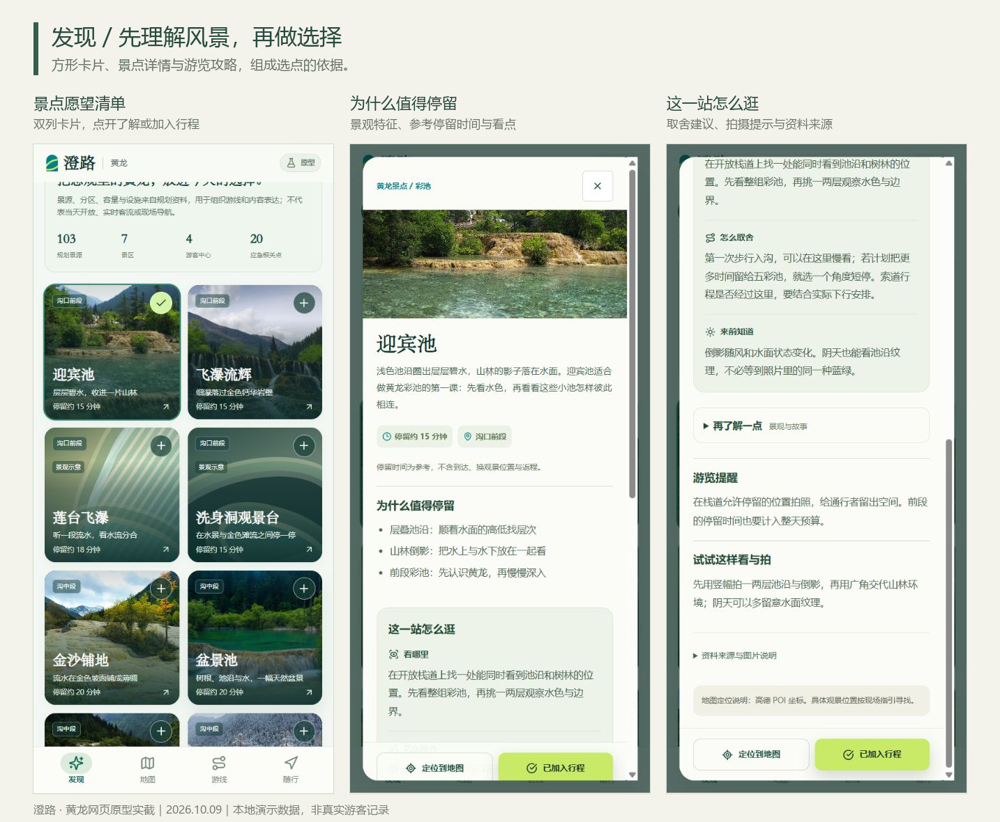
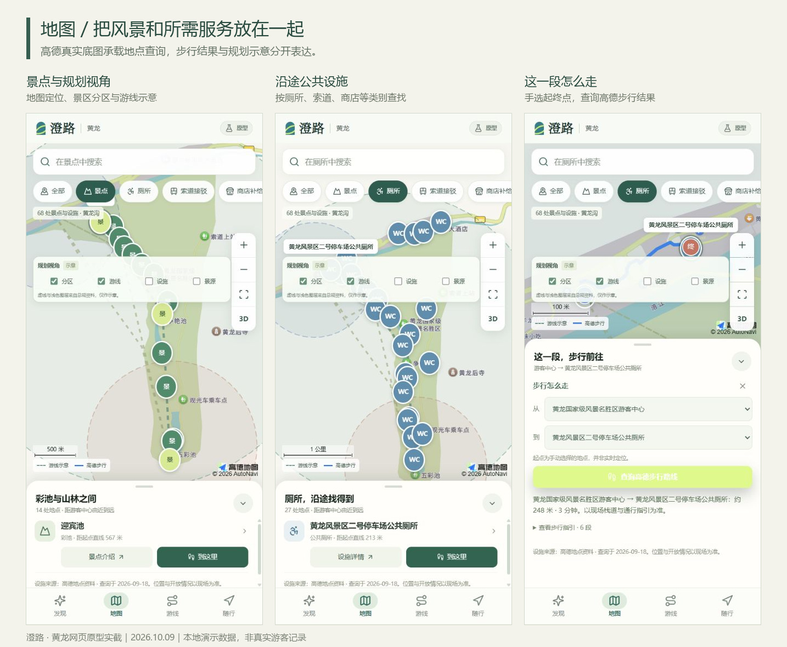
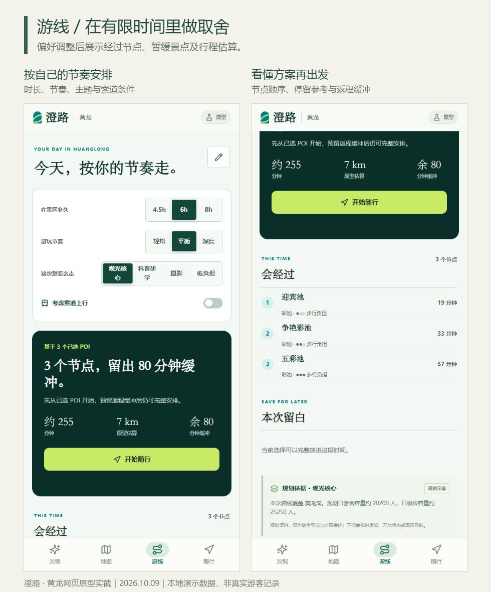
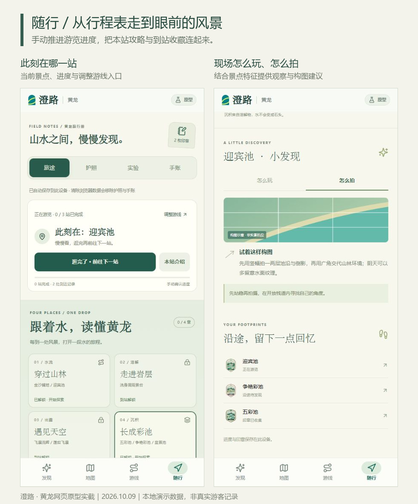
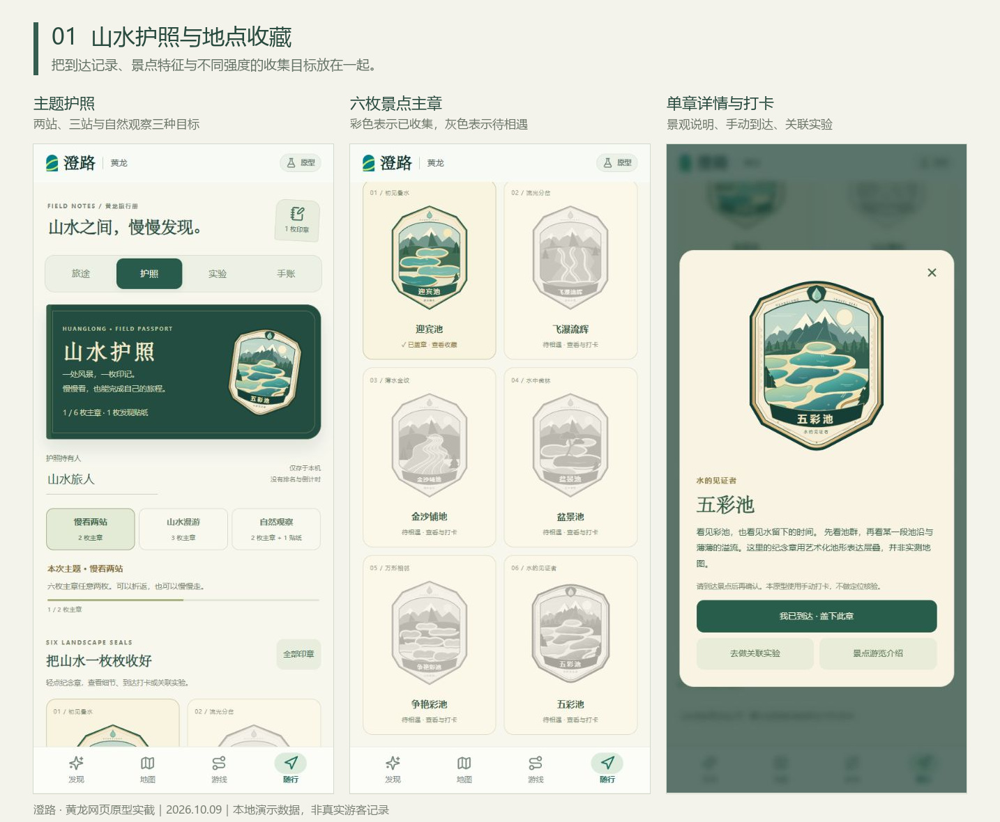
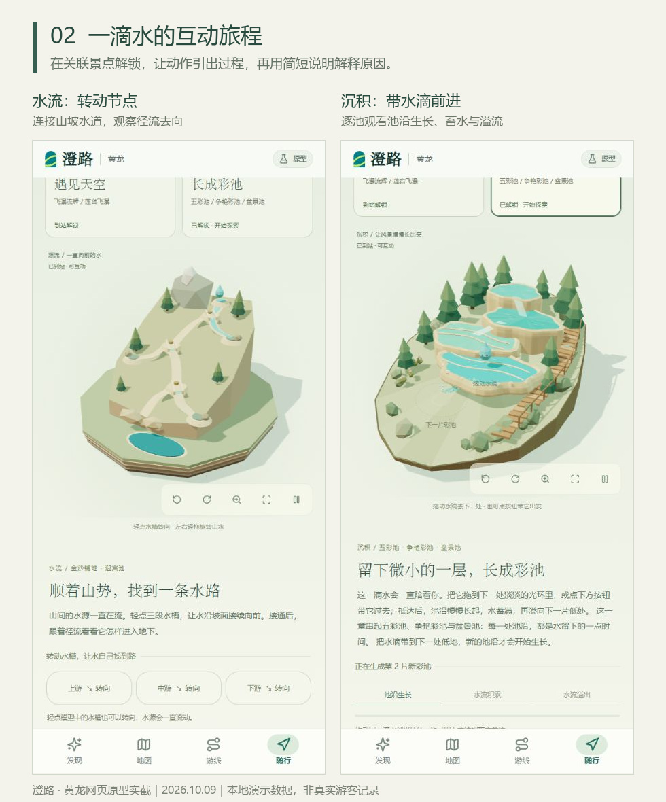
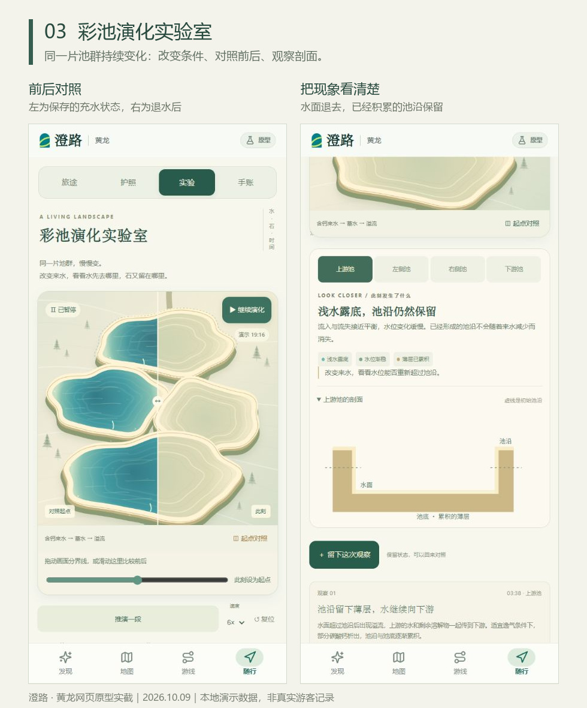
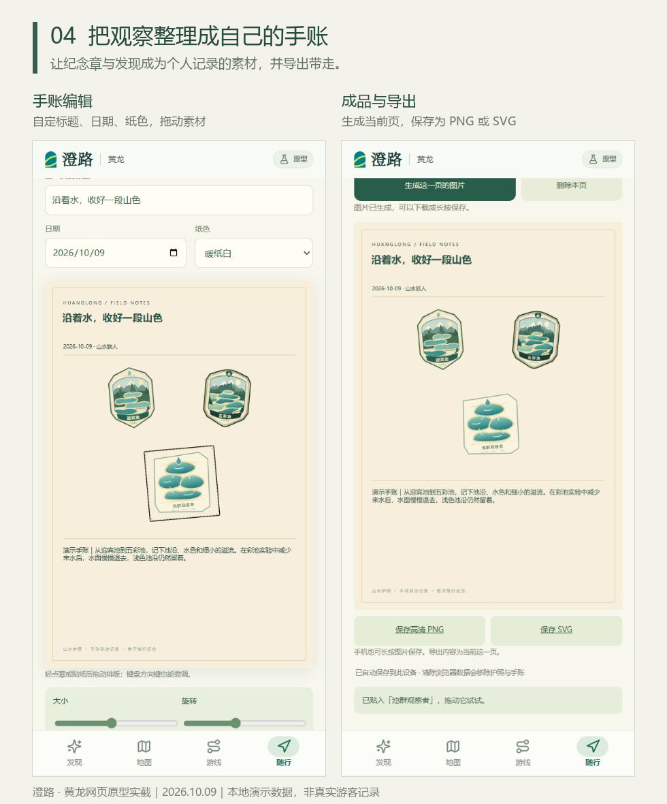

# 澄路 · 图文产品总览

产品状态基于2026-10-08功能版；截图摄于2026-10-09，交接整理于2026-10-13。以下19张真实移动端界面组成8组图版，全部随仓库保存；行程、收藏及手账为本地演示数据，不是游客运营记录。

[在线体验](https://huanglong-route.itsmephrynx.workers.dev/) · [开发交接](../HANDOFF.md) · [返回首页](../README.md)

面向黄龙这类路径自由度较小的景区，系统把景点选择、沿途服务与到站体验连起来。底部主导航是发现、地图、游线、随行；随行内再分旅途、护照、实验与手账。

## 发现：看懂景点再加入行程

14处景点的方形卡片、详细介绍与本站攻略。支持按名称、别名或看点搜索及景观类型筛选。

## 地图：景点与沿途服务

68条景点和设施记录、真实高德底图、手选起终点的步行查询。设施为资料快照；规划分区及游线虚线不代表实时通行。

## 游线：解释选择与取舍

按时长、节奏、主题和索道条件组织已选POI，显示节点、暂缓原因与缓冲。整体时间、距离为原型估算。

## 随行：进度与现场攻略

手动推进游览，查看本站怎么玩、怎么拍；到达与游完分开记录。

## 山水护照：六枚地点纪念章

六枚主章、三种主题与不同强度收集目标。手动确认到达，不构成实物兑换凭证。

## 一滴水的四章3D旅程

水流、溶解、出露、沉积各有明确动作与过程反馈。图中是水流和沉积两章；到关联POI解锁，保留同一滴水作为视觉锚点。

## 彩池演化实验室

同一片池群持续演化；调整来水、溶解钙、逸散与光照，暂停/步进、比较前后、看剖面、留观察。定性科普模型，不推算真实年限。

## 数字手账：留下自己的观察

使用已收集素材编辑最多12页手账，拖动、缩放和旋转，逐页导出PNG/SVG。实验记录可转成手账文字。

## 线下联动与后续边界

线下仍是策划：薄水观察折页、池沿三层书签、纹板拓印与个人折册，强调黄龙水色与层积特征。详见[联动策划](黄龙山水护照与实体纪念品联动策划.md)及[结构概念图](souvenir-structures.svg)。未建立实物领取、库存或核销服务。

网页尚无账号同步、GPS真实打卡、景区实时设施状态或完整离线缓存。社媒链接与OCR是预留入口，现有文字导入只匹配目录中的POI。完整实现范围、验证记录和接手注意事项见[HANDOFF](../HANDOFF.md)。
